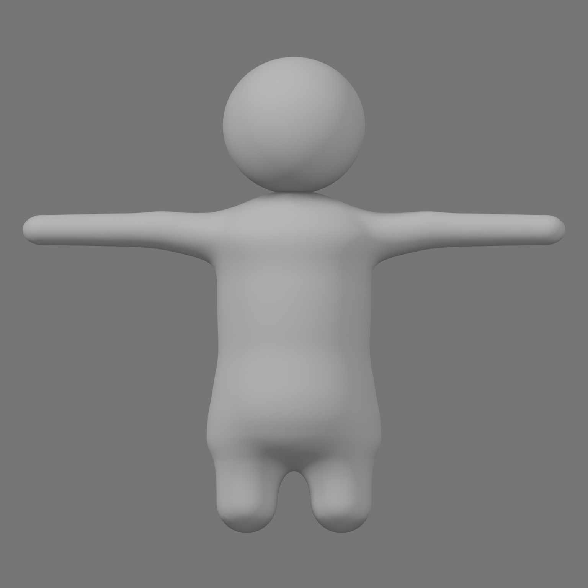
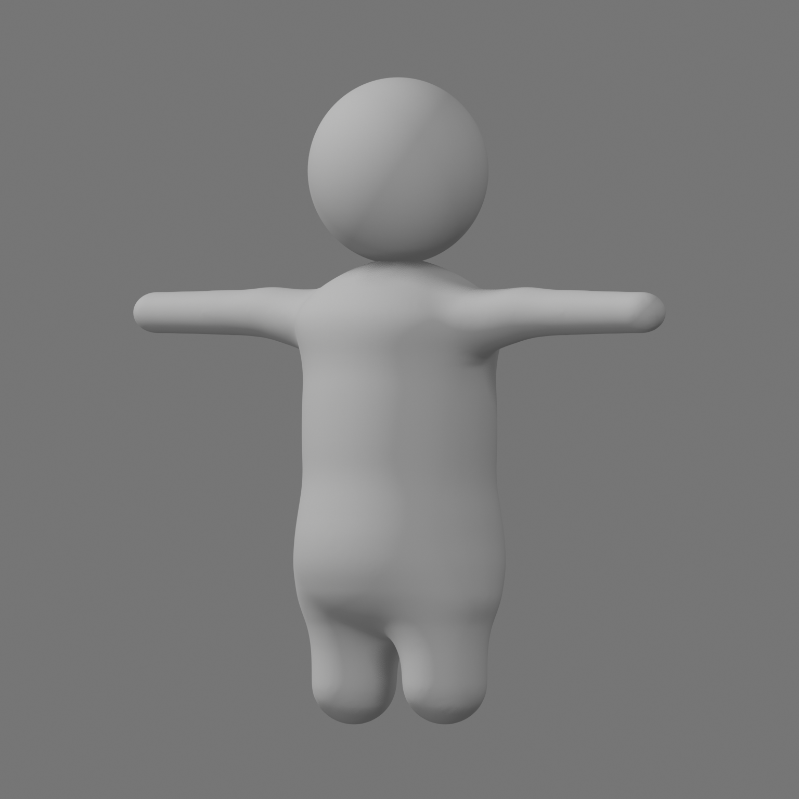
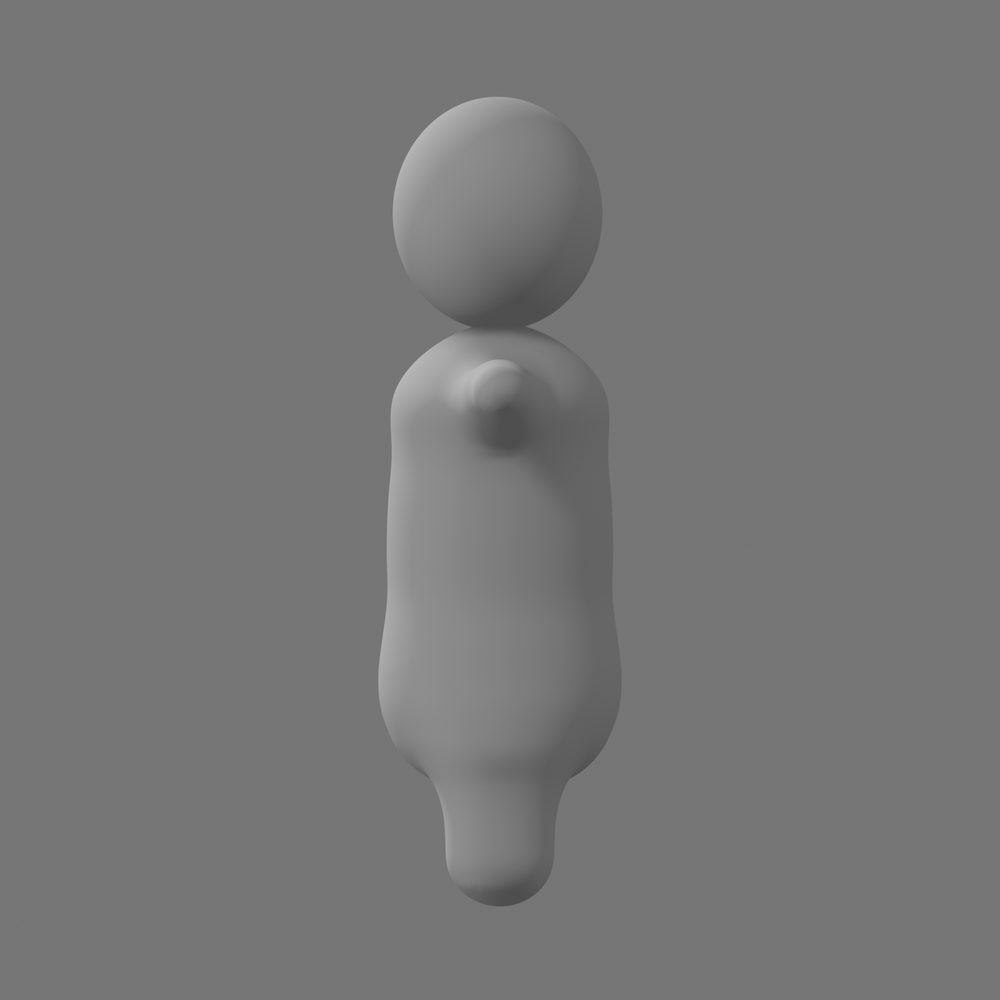
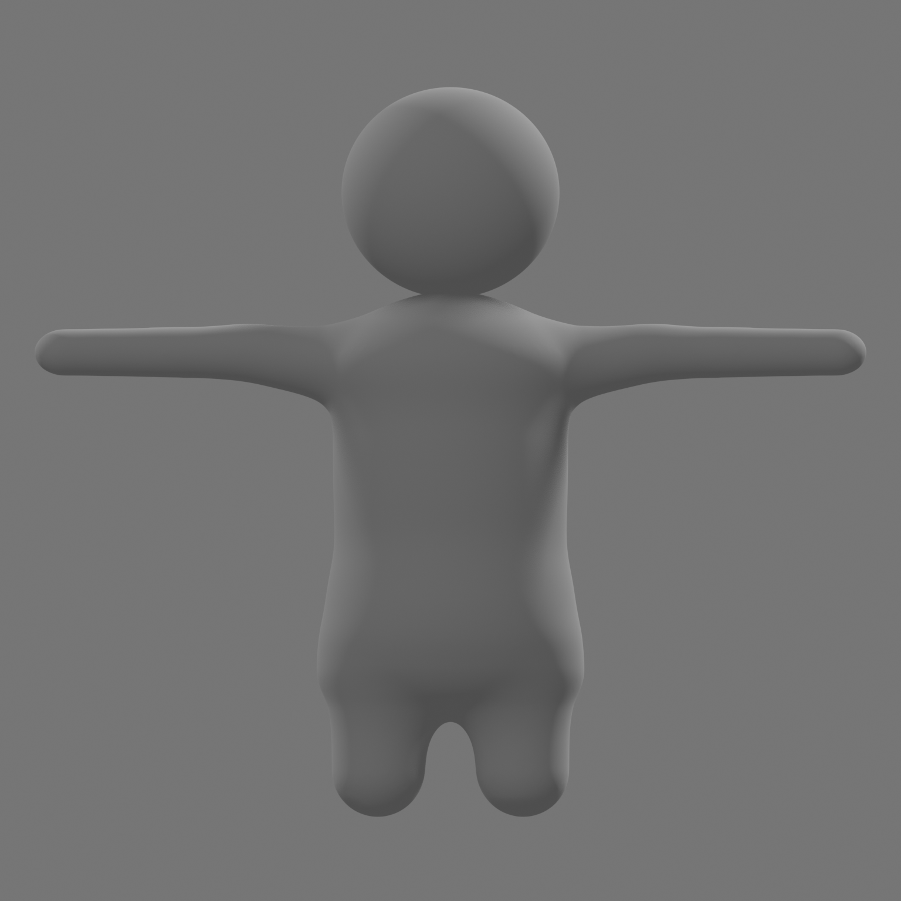

# Character Rework 현재 검토 기록

2026-10-15 r40 — **기본 형태 재제작·어깨 보조 뼈 3개·펀치 타격감 적용, 사용자 검토 대기**: 저폴리 기본 형태+서브디비전으로 이음매 없는 몸을 다시 만들고 대기 자세 기준으로 피부를 입혔다. 펀치는 넉백·정지 프레임·섬광·주먹 구동을 추가했다. BodyStrike 메뉴가 `C1B-RW-040-cage-body/CageBodyCharacter.bytes`를 연다. [r40 기록](R40_CAGE_BODY_PUNCH_IMPACT_20261015.md)

2026-10-13 어깨 라인 수정 시도 — **미완료·r35 후보 미반영**: 원래 어깨 폭과 현재 팔 굵기를 유지하며 겨드랑이 홈과 접힘을 줄이는 형상·가중치·자세 보정 및 연결 면 재구성을 시험했다. [r35 시도 기록](R35_SHOULDER_LINE_ATTEMPT_20261013.json)과 [검증 자료](../evidence/r35-shoulder-line-20261013/EvidenceIndex.json)에 실제 Unity 실행과 기록된 자세 재생 예측을 구분했다. 후보 O는 420프레임 연속 들기/굽힘/펀치의 최대 면 꺾임을 원본64.04°에서39.47°로 낮췄지만 실제 전투9상황 중7상황에서 표면 검사를 실패하고 일부 위팔 단면이 축소되어 거부했다. 경계 보정 Q도 다른 자세에서 접힘이 커졌다. 위가슴·등까지 넓힌 마지막 중립 연결 면도 네 방향에서 능선과 주름이 남아 거부했다. 기본 모델은 r34, 펀치는 기존 BodyStrike/r29를 유지하며 기존 소스40개와 r34 모델 두 파일의 해시가 동일하다. 어깨 문제 해결이나 사용자 시각 승인으로 취급하지 않는다. 이번 범위에서는 이전 해결안의 팔 전체20~25% 확대를 적용하지 않았다.

2026-10-10 최신 진행 — **r34 몸통·사타구니 곡면 반영, 어깨·팔 해결안 제공**: [r34 곡면 정리 기록](R34_FAIR_BODY_20261010.json)은 r33의 어깨 폭·팔 몸체·뼈대·가중치·펀치/피격 동작을 유지하며 몸통과 사타구니의 실제 형상을 다듬는다. 9,043개 정점의 곡면 가이드에서 일정한 물리적 범위로 곡률을 정리하고 기존 변형 좌표를 유지해 움직일 때의 접힘과 확대 조명의 잔주름을 함께 검토했다. 최대 중립 변화 약7.1mm, 좌우 좌표 대칭 오차0, native/Unity 위치·노멀 일치, 연결된 body1개·경계/비다양체 모서리0, 실제 네 자세의 지정 영역에서 면 관통0건을 확인했다. 최종 CandidateK는 PlayMode9/9·전투9상황·15/60/144FPS·고정 접촉면 검사를 통과했고 기본 메뉴 변경 후 컴파일/EditMode1/1도 통과했다. 같은 정면 구도에서 원래 어깨 윤곽과 팔·몸통 틈 픽셀93개는 동일하다. 두 BodyStrike 메뉴는 `C1B-RW-034-fair-body/FairBodyCharacter.bytes`를 연다. [어깨·팔 해결안](SHOULDER_ARM_FIX_PLAN_20261010.ko.txt)은 원래 어깨 폭 유지, 연결 면 재배치, 원통형 팔 굵기 조정, 좁은 관절 가중치·국소 부피 보정과 검증 목표를 제시하며 아직 구현하지 않았다. 사용자 시각 승인으로 취급하지 않는다.

2026-10-10 최신 사용자 교정 — **r33 국소 수정 반영**: 넓어진 어깨를 거절하고 원래 어깨 형태에서 팔·몸통 틈을 거의 없게 줄이도록 지시했다. [r33 틈 보충 기록](R33_CLOSE_ARM_GAP_20261010.json)은 원래 r28 어깨 좌표·뼈대·가중치·팔 외곽·동작을 유지하며 겨드랑이 아래 몸통 옆면만 최대 약1.65cm 채운다. 좌우 좌표 대칭 오차0, native/Unity 위치 일치와 모델 경로 한 줄 외 기존117개 소스 해시 일치를 확인했다. 같은 정면 구도의 지정 영역에서 배경으로 보이는 틈 픽셀이416→93으로 줄었고 어깨 윤곽은 동일하다. 첫 후보의 GrabPunch 표면 실패를 수정한 최종 CandidateC는 PlayMode9/9·전투9상황·15/60/144FPS·고정 접촉면 검사를 통과했으며 메뉴 수정 후 Unity 컴파일과 기존 EditMode1/1도 확인했다. 두 기본 BodyStrike 메뉴는 `C1B-RW-033-close-arm-gap/CloseGapCharacter.bytes`를 연다. 원래 깊은 어깨·팔꿈치 굽힘의 접힘/축소를 해결한 리깅 교체나 사용자 시각 승인으로 취급하지 않는다.

2026-10-10 관절 배치 변경 재시도 — **미완료·r32 후보 미반영**: 이전의 물리 관절 배치 보존 제한을 풀고, 실제 좌우 어깨 연결점을 x±0.18에서±0.23으로 변경했다. 쇄골~위팔의 연결 거리와 기본 팔 자세를 바꾸고, 어깨 구멍과 팔의 연속된 면 흐름·변형용 뼈를 함께 구성했다. 실제 Unity에서 변경된 배치와 약120도 굽힘 시 단면적 약99.9% 유지를 재현했으나 어깨 접합부의 면 뒤집힘과 일부 접촉면 오차를 해결하지 못했다. [r32 재시도 기록](R32_SHOULDER_SOCKET_RETRY_20261010.json)에 실제 관절 위치·실측값·실패 검사와 원본 보관 위치를 기록했다. 실험 런타임을 복구했으며 원래 소스118개의 해시 일치와 기존 동작 검증4/4 통과를 확인했다. 기본은 r28 모델+r29/BodyStrike이며 요청한 수정의 완료로 취급하지 않는다.

2026-10-09 후속 재시도 — **미완료·r31 후보 미반영**: 중립/A자세 바인딩, 굽힘용 보조 뼈, 연결면 재구성, 자세 보정과 실시간 표면 보정을 비교했다. 팔꿈치 약120도에서 단면적 약99%를 유지하는 후보는 만들었지만, 어깨 이음선·접힘·다른 자세의 면 뒤집힘을 함께 해결하지 못했다. [r31 재시도 검증 기록](R31_ARM_REBIND_REJECTED_20261009.json)에 실제 Unity 단면 측정과 실패한 연속 전투 검사, 후보 및 코드 보관 위치를 기록했다. 실험 런타임을 되돌린 뒤 기존 소스118개와 r28 모델 두 파일의 해시 일치를 확인했고, 복구 확인 PlayMode4/4가 통과했다. 기본은 r28+r29/BodyStrike이며 요청한 모델링 수정은 아직 완료되지 않았다.

2026-10-09 진행 결과 — **미완료·후보 미반영**: 어깨·팔꿈치·팔 굵기를 함께 수정하려 했으나, 일부 후보에서 팔꿈치 단면이 개선되어도 어깨 접힘과 다른 자세의 형태 왜곡이 남았다. [실패한 r30 시도 기록](R30_ARM_REVISION_REJECTED_20261009.json)에 측정값·실패한 검증·후보 보관 위치를 기록했다. 실험 런타임 변경은 되돌렸고 기본 모델은 r28, 동작은 r29와 기존 BodyStrike를 유지한다. 모델 두 파일과 r29 기록의 동작/펀치 소스 해시 일치를 확인했고, 복구 후 접촉면·어깨 리셋·피격 회복·15/60/144FPS 검사 4/4가 통과했다. 이 검사는 복구 확인이며 요청한 모델링 수정의 완료 또는 시각 승인으로 취급하지 않는다.

2026-10-08 최신 재검토: 사용자가 어깨 접힘·팔꿈치 굽힘 시 축소·몸통 대비 가는 팔을 다시 지적했다. [관절 단면 감사](ARM_VOLUME_AUDIT_20261008.json)는 r28 모델+r29 동작 그대로 10개 자세를 재현하고 Unity bake 메시를 절단해 측정했다. 팔꿈치 약90도에서 팔꿈치 단면적 약16%/전완 중앙 약34%, 약120도에서 각각30%/50% 감소를 확인했다. 어깨에는 띠 모양 접힘이 남고, 중립 상완/전완 대표 지름은 몸통 중간 너비의 약21%/19%다. 기존 검사 통과는 이 시각 문제의 해결을 보장하지 않았다. 이번 작업은 재현·측정·수정안이며 모델과 동작을 바꾸지 않았다. 수정안은 팔 전체 지름 약25% 증대 비교, 어깨 접합부 면 흐름/가중치 재구성, 팔꿈치 부피 보존 구조와 실제 단면 기준 추가다.

2026-10-08 최신 진행: 사용자가 팔만 앞으로 뻗는 자세를 어색하다고 지적하여 [r29 어깨 연동 동작](R29_NATURAL_SHOULDER_MOTION_20261008.json)을 적용했다. r28 모델 파일은 그대로 유지하고 BodyStrike에서 실제 팔/손 방향에 맞춰 쇄골과 물리 어깨 연결점을 함께 갱신한다. 손 뻗기에는 몸통 기울임을 더하고, 펀치는 어깨 후인 준비→전인→회수를 기존 가슴 회전에 연결한다. 타격 판정·주먹 동작 기준·피격 곡선은 유지하며 취소/리셋과 고정 스텝 접촉면을 검증했다. PlayMode9/9·별도 전후 비교1/1·EditMode146/146 및 전투9장면,15/60/144FPS 검사를 통과했다. 비교 영상은 실제 입력을 동일하게 재생하며 좌측 이전/우측 수정,0.5배속이다. 기존 팔45/90도 고정 사진은 메시 검사 자세이며 자연스러운 게임 동작으로 제시하지 않는다. 사용자 시각 승인은 아직이다.

2026-10-08 최신 사용자 교정: r27의 잘록한 이두·삼두 부분을 거절하고 위팔도 원통형으로 채우도록 지시했다. [r28 원통형 위팔 보충](R28_CYLINDRICAL_UPPER_ARMS_20261008.json)은 위팔의 피부 중심선을 기준으로 둥근 단면을 채우고 24개 자세 보정에도 같은 볼륨을 적용한다. 어깨·팔꿈치 접합부 곡률을 정리하며 기존 가중치·뼈대·머리·동작 곡선·mesh 연결 및 편집 범위 밖 좌표를 보존했다. 좌우 형상 오차0, native/Unity 일치, PlayMode7/7·EditMode146/146, 전투9장면 표면 및 고정 접촉면/FPS 검사를 통과했다. 기본 두 BodyStrike 검토 메뉴는 r28을 연다. 팔 들기/펀치 전후 이미지와 동작 영상을 저장했으며 사용자 시각 승인으로 간주하지 않는다.

2026-10-08 최신 진행: 사용자가 r26 방향을 받아들이고 몸통·팔의 잔요철 정리안 진행을 지시했다. [r27 몸통·팔 표면 정리](R27_SURFACE_REFINEMENT_20261008.json)는 현재 체형에서 연속된 곡면과 팔 단면을 정리하고, 어깨·팔꿈치·허리 가중치의 연결 폭 및 4개 skin slot 경계를 수정한다. 좌우 대칭 위치/노멀 보정24개를 원본과 Unity에 저장하며 고정 물리 접촉면에도 같은 보정을 적용한다. 머리·뼈대·동작 곡선·mesh 연결 및 하체 y≤0.16의 좌표/가중치를 보존했고, 형상·가중치 대칭 오차는0이다. 승인한 펀치/피격/이동7개 소스 해시는 동일하다. 최종 PlayMode8/8·EditMode146/146, 좌우/머리/헛손질/벽/잡고 치기/연타/이동/서로 공격9장면의 표면 검사, 15/60/144FPS, 렌더 보간과 무관한 보정 접촉면 일치를 통과했다. 전후 확대 이미지와 실제60FPS 동작 영상을 저장했다. 두 기본 BodyStrike 검토 메뉴가 r27을 연다. 사용자 시각 승인이나 정식 Player/네트워크 검증으로 취급하지 않는다.

2026-10-08 최신 진행: 사용자는 r25의 표면 마감을 거절하고 **베이맥스처럼 매끈하고 둥근 몸**을 명확히 요청했다. [r26 곡면·음영 정리](R26_SMOOTH_BODY_20261008.json)는 갈비뼈 보충을 복부까지 넓게 연결하고 표면 곡률을 다듬는다. 실제 면에 맞춘 노멀과 좌우 대칭 자세별 노멀 보정6개를 원본/Unity에 저장했다. 노멀 보정의 위치 변화량은 Unity bake 비교에서0이며, 펀치·피격·이동7개 소스 해시는 승인본과 동일하다. 정면·측면·사선·양팔45/90도, 허공 펀치, 피격 상태,15/60/144FPS 재생을 포함한 PlayMode5/5 및 EditMode146/146을 통과했다. 머리·뼈대·원래 가중치·topology는 보존한다. 기존 강한 피격의 메시 자체 접힘을 고치는 리깅 변경은 하지 않았고, 전체 전투 표면 통과나 사용자 시각 승인으로 취급하지 않는다. 기본 두 검토 메뉴는 r26을 연다.

2026-10-08 최신 사용자 교정: r24 펀치는 괜찮다고 평가했으나, 모델 전체 재구성은 명시적으로 거절했다. 원래 r23에서 갈비뼈 옆면만 채워 팔과 몸통 사이 공간을 줄이라는 지시로 [r25 국소 갈비뼈 보충](R25_LOCAL_RIB_FILL_20261008.json)을 반영했다. 몸체 원본 X좌표 중 갈비뼈 영역만 최대3cm 이동하고 Y/Z·머리·어깨 윗면·팔다리 끝·뼈대·전체 가중치·topology를 보존한다. 펀치/피격/이동 관련7개 소스 해시가 승인된 버전과 동일하다. 기본 두 검토 메뉴는 r25 모델과 승인된 BodyStrike를 사용한다. 정면·45/90도 팔 들기·허공 펀치 및 피격 상태 검사는 통과했다. 강한 피격/잡고 치기의 전신 표면 접힘은 원래 r23 대조군에서도 재현되는 남은 문제로 기록하며, 전체 표면 검사가 통과했다고 취급하지 않는다.

2026-10-08 최신 진행: 사용자가 r23 모델과 공격 A/B의 체감을 거절하고 갈비뼈 전체 볼륨과 공격·피격의 동시 재설계를 지시했다. [r24 몸통·타격 재작업](R24_BODY_IMPACT_REWORK_20261008.json)은 가슴~상복부를 연속된 넓은 형태로 다시 만들고 어깨/팔꿈치 영향도를 재구성한다. 좌우 형상·가중치 대칭 오차0, 몸체 연결 성분1·비다양체 모서리0 및 머리/24개 뼈 보존을 검증했다. BodyStrike는 골반·몸통 준비와 전진, 실제 접촉에서의 반동, 방향/부위별 피격·회복을 연결한다. 최종 PlayMode10/10·EditMode146/146, 9개 실접촉 장면, 양팔45/90도, 취소/초기화, 15/60/144FPS 재생을 통과했다. 영상은 artifacts/previews/r24-body-impact-20261008 에 있고 두 기본 검토 메뉴가 r24를 연다. 사용자 시각·체감 승인 및 전체 게임 통합 완료로 취급하지 않는다.

2026-10-08: 사용자가 r22 모델·펀치의 체감 결과를 거절하고 수정안의 진행을 지시했다. [r23 모델·공격 비교](R23_MODEL_ARC_COMPARISON_20261008.json)는 어깨 연결부와 겨드랑이의 볼륨을 다시 잡고 좌우 좌표를 정확히 반사했다. 머리·24개 뼈·topology는 보존한다. 횡스윙 A와 대각선 내려찍기 B를 별도 Unity 메뉴로 제공하며, 실제 팔 말단 접촉·방향별 명중과 한손 잡기/타격/해제 흐름을 검토한다. 두 후보 각각8장면,15/60/144FPS 재생·취소·잡기/던지기 및 EditMode146/146 검사를 확인했다. 정면 대칭 조명 비교와 실제 원속도 영상을 준비했다. 처음 실패한 잡고 치기 장면은 수정 후 다시 실행했으며 과거 실패 로그도 보존했다. 후보 선택·사용자 시각/체감 승인·전체 게임 통합은 아직 아니다.

2026-10-07 사용자의 어깨·겨드랑이 및 펀치 수정 지시로 [r22 모델과 전투 재작업](R22_SHOULDER_PUNCH_REWORK_20261007.json)을 구현했다. 실제 Unity Idle 변형에서 어깨의 내려오는 곡면을 보정하고 기존 skin helper의 국소 가중치를 조절했다. 원본 r21·24개 뼈·topology·머리·하체·말단 팔은 보존했다. `Open Physical Punch Candidate`는 새 r22를 사용한다. 펀치는 몸 앞의 짧은 준비·빠른 신전·준비 자세 회수, 연타 사이의 임시 양손 guard와 실제 명중에만 발생하는 제한된 몸 반응을 연결했다. 잡은 손의 자세·기존 점수/Down 요청 경계는 유지한다. PlayMode 고유 검사21개·EditMode146/146, 실제 좌우·머리·사거리 밖/벽·연타·이동·잡고 치기8조건 및15/60/144FPS 재생 검사를 통과했다. 정면 전후 이미지와 무음 전후 비교·실제 명중음 난투 영상을 새로 촬영했다. 기술 검사를 사용자 시각·체감 승인이나 전체 게임 통합 완료로 취급하지 않는다.

2026-09-17 사용자가 서 있는 상대·상호 잡기 후보를 시각 승인하고 다음 진행을 요청했다. [물리 팔 펀치·정밀 접촉 후보](R20_PHYSICAL_PUNCH_CANDIDATE_20260917.md)는 승인된 빠른 펀치를 관절 힘으로 따라가며 실제 손끝 접촉으로만 명중을 기록한다. 짧은 클릭/유지 잡기/해제 던지기를 연결하고 머리2점·몸통/팔다리1점을 누적한다. 이 단계는 첫10점의 Down 요청까지이며 실제8→12몸체 Down·회복 전환과 잡기 유지 인계는 아직 연결하지 않았다. 기존 기본 장면과 정식 캐릭터/네트워크 Gate는 변경하지 않는다.

사용자는 이전 빠른 펀치를 ‘툭 건드리는’ 느낌으로 평가해 체감 승인을 하지 않았다. [준비·가격·힘 전달 재수정 후보](R20_PUNCH_FOLLOW_THROUGH_20260917.md)는 팔꿈치를 먼저 깊게 접고 어깨를 준비한 뒤 빠르게 뻗으며, 명중 직후 시간을 건너뛰어 회수하던 동작과 손의 역방향 보조 impulse를 제거한다. 몸통의 작은 물리 목표·실제 손끝의 fixed-step 경로 판정·시작 거리로 고정하는 초근접 직선 궤적을 함께 검토한다. 제자리/이동 연타는 각각 첫10명중을 확인했다. 전체0.4초·머리2/몸통·팔다리1점·잡기 유지/해제 던지기는 유지한다. PlayMode19/19·EditMode146/146 및15/60/144FPS 결과 일치를 확인했다. 접촉 후 표시 피부 간격 최대6.97mm는 보완 대상으로 남기며, 사용자 체감 승인 전 다음 Down·회복 단계로 진행하지 않는다.

2026-09-18 최신 진행: 사용자가 흐물거리는 펀치의 재설계 진행을 요청했다. [1단계 참고 원형](R20_PUNCH_REFERENCE_20260918.md)을 전용 무물리 장면으로 제작하고 정면/측면·좌우 단발을 검토한다. Rigidbody/Collider0, 대칭·접지·원위치 복귀와 공유 로더 경로3/3 검사를 통과했다. 기존 물리 펀치·판정·모델은 유지한다. 원형 사용자 승인 뒤 자세·속도 기반 물리 추종과 실제 피격 반응을 검토하며, 이번 결과로 전투 타격감 또는 통합 승인을 가정하지 않는다.

2026-09-17 사용자가 누운 상대 접촉 후보를 승인하고 다음 진행을 요청했다. [서 있는 상대·상호 잡기 접촉 후보](R20_STANDING_SKIN_CONTACT_20260917.md)에서 양쪽 피부를 고정 물리 상태로 계산하고, 팔끼리의 같은 접촉이 중복 처리되지 않도록 연결한다. 손별 소유권을 유지해 한쪽 release가 상대 잡기를 없애지 않으며, 상호 자동 들기 차단과 유효 마지막 손 release Throw를 함께 확인한다. 별도 메뉴에서 검토하며 원본 모델·기본 Shared Arena·정식 캐릭터 Gate는 변경하지 않는다.

2026-09-17 사용자가 들기 후보를 시각/체감 승인하고 다음 진행을 요청했다. 승인한80% 보조·들기 목표·즉시 놓기 던지기를 기준으로 [손/피부 접촉 보완 후보](R20_SKIN_CONTACT_CANDIDATE_20260917.md)를 별도 래그돌 검토 장면에 추가한다. 렌더 보간과 분리된 고정 자세에서 실제 피부 삼각형과 접점을 계산하고, 손·전완 주변 접촉면이 상대 물리 몸체에 힘을 전달한다. 원본 모델·팔 길이·래그돌 자세 drive는 바꾸지 않는다. 이 범위는 서 있는 상대/상호 잡기·새 물리 펀치·상태 전환·게임 전체 통합 완료를 뜻하지 않는다.

2026-09-17 사용자가 **잡아 들고 있는 동안만 부분 중력 보조**하는 방식을 승인했다. [래그돌 들기·놓기 던지기 후보](R20_LIMP_LIFT_ASSIST_20260917.md)를 B 기반 별도 장면에 연결했다. 대상의20kg·관성·중력 설정과 자세 drive0을 유지하며, 유효 잡기/보유자 지지 조건에서만 대상당 한 번 보조하고 해제·상실·공중 전환에 중단한다. 상호 잡기는 추가 자동 상승을 차단한다. 현재80% 보조·팔 구동력·목표 높이는 체감 검토용 수치다. 이번 승인은 들기/해제 후보 범위이며 손/피부 접촉면 보완 승인이나 전체2단계 완료,3단계 전체 완료를 뜻하지 않는다. 기본 Shared Arena·승인 자산은 자동 교체하지 않는다.

2026-09-16 B 선택 후 사용자의 진행 지시로 [어깨 보완·낮은 래그돌 잡기](R20_SHOULDER_REPAIR_LOW_GRAB_20260916.md)를 별도 후보에서 구현했다. 어깨 피부 보조 뼈2개와 국소 가중치로 변형 검사를 통과했고, 골반/상체를 낮춰 실제 래그돌을 잡아 끄는 동작을 확인했다. 손과 피부 사이 간격이 최대 약3.6cm 남아 접점 보완의 추가 진행 여부를 확인 중이다. 이 후보의 시각 승인이나 전체2단계 완료로 간주하지 않으며3단계는 미착수다. 기존 승인 메쉬·22개 뼈 정의·총질량20kg과 기본 Shared Arena는 유지한다.

**2026-09-13 영상 재잡기 반복 수정:** [비교 영상의 불필요한 클릭 재입력](R20_CLIMB_REGRAB_FIX_20260913.md)을 제거했다. 실제 플레이의 연속 클릭은 이미 재시작하지 않으며 런타임 모션/물리는 유지한다.

2026-09-13 사용자 진행 승인으로 [잡기 접촉·벽 복귀 후보](R20_GRAB_CONTACT_CANDIDATE_20260913.md)를 별도 검토 장면에 구현했다. 작은 손·팔 보정과 벽 매달림 간격/등반 종료 표현을 시험하며 기본 Shared Arena는 기존 승인본을 유지한다. 안정된 매달림은 개선했으나 잡기 직전·등반 전환·상호 잡기의 관통은 미해결이다. 상호 접촉을 손목·전완으로 바꾸는 선택과 벽 접근·복귀 때 빈팔을 위로 접어 피하는 전환 동작은 사용자 답변 대기이며 아직 규칙으로 채택하지 않는다.

**2026-09-11 관통 보정안 철회:** [손·팔 접촉 공간 수정안](R20_GRAB_CONTACT_CLEARANCE_20260911.md)은 모션을 과도하게 바꿨다는 사용자 지적으로 철회했다. 직전 자동 들기·상호 들기 차단·상향 벽 잡기 버전으로 복원한다. 관통 문제는 미해결이며 승인된 모션을 유지하는 방향으로 다시 다뤄야 한다.

**2026-09-11 자동 상향 들기·상호 차단:** 사용자 승인으로 [클릭 유지 중 들기/위쪽 벽 잡기](R20_AUTOMATIC_LIFT_REVIEW_20260911.md)를 기본 시제품에 연결한다. 서로 잡은 쌍은 양쪽 자동 상승0, 마지막 손을 놓으면 진행도와 무관하게 즉시 던진다. 기존 하중 피로와 벽 복귀 예산을 유지한다.

**2026-09-10 매달림 자세 보완:** [한손/양손 하중 반응](R20_HANGING_LOAD_REVIEW_20260910.md)을 기본 정적 가장자리 시제품에 연결했다. 실제 지지력을 읽어 골반 기울임·중앙 처짐·자세 전환을 표현한다. 손 접촉과 기존 잡기/복귀 물리는 유지하며 사용자 체감 확인은 남아 있다.

**2026-09-10 가장자리 복귀 연결:** 승인한8.8×6.2CU·22CU 카메라와2배 이동을 기본으로 사용하며 [정적 Lip/Facade 잡기·ClimbAssist](R20_LEDGE_RECOVERY_REVIEW_20260910.md)를 연결한다. 깊이에 따라1~2회 보조로 복귀하고, 공중당2회/350ms·피로·해제·FPS 경계를 검토한다. Beam/움직이는 표면과 경기 흐름은 후속이다.

**2026-09-10 기본 이동 속도 채택:** 사용자가 [2배 속도](R20_MOVEMENT_SPEED_REVIEW_20260910.md)를 선택했다.2·3·4인 Shared Arena의 기본은 걷기1.40/달리기2.10m/s·가속20m/s²다. 보행 모양 승인 뒤의 최신 속도 기준이며, 고정60Hz와 기존 전투 규칙을 유지한다.

**2026-09-10 공용 구도 보행 채택:** 사용자가 비교 영상의 [템포·발 들림·골반 지지 후보](R20_CAMERA_GAIT_CANDIDATE_20260910.md)를 더 자연스럽다고 승인했다.2·3·4인 Shared Arena의 기본 보행에 적용하며, 기존 이동 속도·광배 가중치와 고정60Hz 연산을 유지한다.

**2026-09-09 후속 시제품 기준:** 사용자 진행 지시에 따라 광배 가중치 r07을 [다음 로컬 시제품 기준](R20_LAT_WEIGHT_PROTOTYPE_ADOPTION_20260909.json)으로 채택한다. 원본은 보존하며 최종 캐릭터 Gate 승격은 없다. 다음 [공용 카메라·화면축 이동 검토](R20_SHARED_ARENA_REVIEW_20260909.md)는2·3·4명 Root framing과 개발용 조작 대상 전환을 연결한다.

**2026-09-09 광배 가중치 조정:** [별도 후보](R20_LAT_WEIGHT_ADJUSTMENT_20260909.md)에서 몸통의 팔 추종을 줄이고 겨드랑이 연결부는 보존한다. 펀치0.5초와 최신 누적 정책은 유지하며, 기존 승인 source는 보존한다.

**2026-09-09 빠른 펀치·정밀 판정:** [최신 후보](R20_FAST_PUNCH_PRECISION_20260909.md)는0.5초 펀치, 몸통·팔다리1점/머리2점, 기준10→6점 감소와 기존 Down 시간 증가를 적용한다. 주먹 source 궤적과 별도 부위 query rig를 사용한다. 기존 항상5회는 이전 비교 정책이다.

## 현재 다음 작업의 확인 사항

**2026-09-08 잡힌 상태의 회복:** 사용자 선택에 따라 [분할 래그돌 잡기·하중·회복](R20_RAGDOLL_GRAB_INTEGRATION_20260908.md)을 로컬 시제품에 연결했다. 전체20kg 하중과 부위 접점을 구분하고, 지지/공간이 유효하면 grab을 유지한 채 회복한다.

**2026-09-08 몸통 물리 분할:** [골반·허리·가슴12 body 후보](R20_ARTICULATED_TORSO_REVIEW_20260908.md)를 별도 검토 장면에서 제공한다. 전체20kg과 원본 rig/skin을 유지하고 실제 몸통 굽힘, 가슴 기준 회복 방향, 분산 회복 보조와 재활성화 joint 기준을 연결한다. 기존 단일 몸통은 비교 기준이며 최종 다인 physics profile 승인은 별도다.

**2026-09-08 이전 Down 방식:** [고정 타격·무력 Down](R20_FIXED_HIT_LIMP_DOWN_REVIEW_20260908.md)은 당시의 비교 기준이다. 현재는 위2026-09-09 부위 점수·10→6점 감소 정책으로 대체됐다. 매번 필요한 타격 수는 같고 반복 Down의 대기 시간만 증가한다. 넉다운 중 animation/자세 drive0, 물리 pose 직접 표시이며 골반·하체 GetUp과 handoff 보정은 회복 단계에서 유지한다. 이 문단의 고정 타격 정책은 이전 이력이며 최신 정책의 감소를 금지하지 않는다.

**2026-09-08 골반·하체 회복:** 사용자 요청에 따라 [골반·무릎 중심의 회복 수정](R20_PELVIS_GETUP_REVIEW_20260908.md)을 진행한다. 몸을 낮추고 골반을 발 위로 옮긴 뒤 다리를 펴는 동작을 보강하며, 기립 후 흔들림 보정은 유지한다.

**2026-09-07 회복 직후 흔들림:** [handoff 수정](R20_GETUP_HANDOFF_FIX_20260907.md)에서 완료 tick의 잔여 회복 force/torque와 회전을 정리한다. 기존 회복 clip은 유지한다.

**2026-09-07 회복 자연스러움 재작업:** 사용자가 이전 회복을 어색하다고 지적했다. [무력 래그돌·단계별 회복](R20_NATURAL_GETUP_REVIEW_20260907.md)에서 자세 유지 힘을 없애고 상체·체중 이동·기립을 분리한다. 이전 기술 PASS는 시각 승인이 아니다.

**2026-09-07 회복 애니메이션:** 사용자가 물리 회복 느낌을 확인하고 실제 동작 표현 추가를 요청했다. [앞뒤 GetUp clip2](R20_GETUP_ANIMATION_REVIEW_20260907.md)의 바닥 짚기·몸통/다리 움직임·마무리를 기본 후보 장면에 연결한다. 원본 모델은 유지한다.

**2026-09-06 래그돌·물리 회복 후보:** [12 body 후보](R20_RAGDOLL_RECOVERY_REVIEW_20260906.md)를 별도 장면에서 검토한다. 원본 모델은 유지하며 실제 낙하·측면 정렬·기립 보조·이동 복귀를 연결한다. 회복 느낌의 사용자 검토와 최종 통합은 후속이다.

**2026-09-06 회복 지지면/공간:** [실제 PhysicsScene query](R20_RECOVERY_SUPPORT_REVIEW_20260906.md)를 Down 상태 어댑터에 연결했다. 공중/이동/막힌 공간에서 기다리고, 지지 상실 시 같은 episode에서 다시 평가한다. 실제 Ragdoll·정렬 운동·GetUp 연출/완료는 후속이다.

**2026-09-06 넉다운 상태 기반:** [누적·회복 대기·행동 잠금](R20_DOWN_STATE_REVIEW_20260906.md)을 구현했다. Lobby Count0, 중복 episode와 stale/reset, 시간 만료 후 회복 gate를 분리한다.
피격→Down 발동 방식은 사용자 의견 대기이며 실제 Ragdoll/GetUp 물리·연출은 후속이다. 테스트 시간을 기본 게임값으로 확정하지 않는다.

**2026-09-06 들기·던지기 공통 물리:** [API/pose 검토](R20_LIFT_THROW_PHYSICS_REVIEW_20260906.md)를 진행했다.
실제 들기·내리기·bounded throw와 중복/강제 해제 방지를 구현했다. 후속 사용자 결정으로 [클릭 유지 Grab→마지막 손 release Throw](R20_RELEASE_THROW_REVIEW_20260906.md)를 기본 local 입력에 연결한다. 별도 들기 키·자동 들기는 사용하지 않는다.

**현재 잡기 점프 기준:** 사용자 후속 요청으로 [75% 부분 보정](R20_HELD_JUMP_WEIGHT_20260906.md)을 채택했다.
같은 체급 수동 상대 한 명은 약17.54cm로 solo23.19cm보다 낮고, 둘은 약15.85cm로 더 낮다. 중력·질량은 유지한다.
아래 solo 높이와 같았던100% 보정은 이전 단계의 비교 이력이다.

**2026-09-06 잡기 점프 높이:** 사용자 요청으로 [하중 점프 보정](R20_HELD_JUMP_ASSIST_20260906.md)을 적용했다.
같은20kg 상대를 잡은 상승 높이가 약5.35→23.19cm로 올라가 혼자 점프와 같아졌다. 양손 중복·동시 점프의 추가 상승 중첩을 막고8방향/착지를 검토했다.
모델·리그·혼자 점프 설정은 유지하며, 지원 질량/운동량 상한과 최종 체감 검토는 별도로 기록한다.

**2026-09-06 실제 잡기·하중 피로:** [잡기 물리 검토](R20_GRAB_PHYSICS_REVIEW_20260906.md)에 contact·joint·해제와 팔 IK를 연결했다.
사용자 결정대로 하중에만 피로가 쌓인다. 잡기+펀치·점프·끌기·대상/접촉 상실 등22조건을 검증했다.
원본 모델·리그와 이동 최고속도는 유지하며 Lift/Throw·피해/Down·실제2인 조작은 후속이다.

**2026-09-06 손 입력·실제 타격:** [로컬 손 타격 검토](R20_HAND_STRIKE_REVIEW_20260906.md)에150ms tap/hold·권한 sweep·중복 방지·표적 충격과 Esc/Reset을 연결했다.
승인 접지·펀치 표현은 유지한다. GrabSeek는 intent까지 구현했으며 실제 Grab joint/Release/Break·피해/Down·네트워크는 후속이다.

**2026-09-06 승인 펀치 Unity 조합:** [펀치 표현 통합](R20_UNITY_PUNCH_INTEGRATION_20260906.md)을 진행했다.
승인된0.10초 준비·0.70초 L/R 펀치를 접지 보행에 연결했다. 이동/점프·좌우 소유권·중단/Reset8조건과 전체 EditMode85/85·PlayMode23/23을 통과했다.
J/K는 검토 전용이며 실제 Hand Intent·Hit·Grab 물리 연결은 다음 범위다.

**2026-09-06 현재 프로토타입 기준:** 사용자가 [접지 절충안](R20_FOOT_PLANT_CANDIDATE_20260906.md)을 채택했다.
기본 실행은 Walk0.70/Sprint1.05m/s·주기3.0/4.5Hz를 사용한다. 모델·리그는 유지하고 첫 통합 플레이테스트에서 조작감과 재작업 필요성을 다시 판단한다.
채택 전 검증은 평지 정속 발 고정16조건·점프 전환18조건·PlayMode21/21 통과다.
발바닥 표면의 바닥 침범 최대6.8mm와 지형 접지·최종 체감 검토는 남는다.

아래는 이전 단계의 검사·승인 이력이며 현재 기본 설정은 위 채택 결정을 따른다.

**2026-09-06 월드 발 고정 별도 검사:** [현재 리그의 도달 범위](R20_WORLD_FOOT_PLANT_FEASIBILITY_20260906.md)를 실제8방향 이동으로 측정했다.
현행 속도·주기로는 지지 전체 고정이 불가능하며, 사용자가 속도·발놀림 절충 후보 제작을 승인해 별도 비교를 진행한다.
선택 PlayMode 검사1/1 PASS. 기본 보행 설정은 유지하며 접지 보정 완료로 표시하지 않는다.

**2026-09-06 보행 재작업:** 사용자 지시로 [기본 보행 표현](R20_READABLE_GAIT_REWORK_20260906.md)을 다시 만들었다.
현재 속도·주기를 유지하며 발 들림·보폭·골반 체중 이동을 보강했다. 기본 시제품은 ReadableGait이며 빠른 발/느린 이동 후보는 미적용이다.
전체 EditMode85/85·PlayMode19/19, 보행 한 주기 표면 검사와 기존8방향 전환 조건을 통과했다.

**2026-09-06 캡처 정정:** 사용자 지적으로 Unity 영상의 skinned mesh 갱신 누락을 확인하고 수정했다.
이전 Unity 영상은 팔다리 표현의 시각 증거에서 제외한다. [정정 기록](R20_SKINNING_CAPTURE_FIX_20260906.md)을 따른다.
기존 영상에 근거한 보행 후보 선택은 보류하며, 모델·기본 속도/동작 설정 변경은0이다.

[발 접지 스타일 비교](R20_FOOT_CONTACT_STYLE_REVIEW_20260905.md)에서 현재 속도/리듬과 다리 도달 범위 차이를 확인했다.
속도 유지·빠른 발놀림과 속도 낮춤·기존 리듬 후보를 비교했으며 사용자 선택 대기다.
기본 설정에는 적용하지 않았다. 기본8방향 전환과 전체 EditMode85/85·PlayMode16/16 회귀는 통과했다.

[8방향 점프 전환 검토](R20_JUMP_TRANSITION_REVIEW_20260905.md)를 추가했다.
보행/Sprint·착지·정지, 공중 반전과 yaw torque, 빈 팔 layer를 연결했고18조건·3,780physics step,
전체 EditMode85/85·PlayMode15/15를 통과했다. 정밀 stance foot 고정과 실제 hand/게임 상태 통합은 후속이다.

사용자가 [물리 점프 전환](R20_PHYSICS_JUMP_DECISION_20260905.json)을 승인했다.
전용 Jump/착지 clip 제작은 중단하고 기존 Action5는 비교 자료로 보존한다.
[Unity 물리 점프 시제품](R20_UNITY_PHYSICS_JUMP_REVIEW_20260905.md)을 구현했다.
EditMode85/85·PlayMode14/14 통과, 승인 모델로 clip0·180physics step/렌더60장을 검토했다.
현재 단일 capsule+하체 pose이며 보행·최종 발 IK·다관절 Ragdoll·게임/네트워크 통합은 후속이다.

승인 펀치 이후 Jump/착지 사전 검사에서 큰 하체 굽힘의 표면 뒤집힘을 발견했다.
[하체 변형 감사](R20_CROUCH_DEFORMATION_AUDIT_20260905.md)에 비교와 weight-only 후보 검토 제안을 기록했다.
사용자가 하체 weight-only 별도 후보 제작을 승인해 [하체 웨이트 후보](R20_LOWER_WEIGHT_REVIEW_20260905.md)를 만들었다.
굽힘·보행·승인 펀치·Grab/Wall 92표본의 표면 검사 PASS이며 [후속 사용자 승인](R20_LOWER_WEIGHT_VISUAL_APPROVAL_20260905.json)으로 후보를 채택했다.
후속 [점프·착지 시제품](R20_JUMP_LANDING_REVIEW_20260905.md)의 Action5에서 평지 접지 pose를 보정했다.
원래 깊은 자세의 표면 접지 잔차3.53mm와 새 clip의 접지 검증을 구분한다. Unity 지형 접지·충돌은 별도 구현이다.
이 Jump/착지 Action은 비교 자료이며 원본 weights 변경은0이다.
승인된 펀치를 다시 미승인으로 돌리지 않는다.

## 최신 펀치 준비 속도

**사용자 시각 승인 완료:** 준비0.10초의 팔꿈치 중심 펀치 r02를 사용자가 원하던 결과로 확인했다.
[승인 기록](R20_PUNCH_VISUAL_APPROVAL_20260905.json)을 따른다. 같은 동작 방향·준비 속도는 다시 미승인으로 돌리지 않는다.
실제 gameplay cadence·타격 판정과 Unity/물리 통합은 별도 검증이다.

사용자 후속 요청으로 접는 준비를0.20초에서0.10초로 줄였다. 확장/회수 pose와 속도는 그대로이며
현재 펀치 후보는 [준비 속도 r02 검토](R20_ELBOW_PUNCH_REVIEW_20260905.md)를 따른다.
총기 Grip·Grab/Wall·원본 모델/리그와 실제 gameplay cadence는 변경하지 않았다.

## 최신 펀치 재작업

사용자는 기존 펀치가 타격감 없이 팔을 내미는 것으로 보인다며 팔꿈치 활용을 요청했다.
Grab/Wall 후보는 유지하고 펀치만 준비→어깨 선행→빠른 팔꿈치 신전→접어 회수하는 새 Action2로 교체 검토한다.
[팔꿈치 중심 펀치 검토](R20_ELBOW_PUNCH_REVIEW_20260905.md)가 현재 펀치 입력이며 이전 펀치의 기술 PASS는 역사로 보존한다.

## 최신 상호작용 애니메이션 후보

2026-09-05 후속 진행에서 검토용 Punch L/R Action2를 별도 Blender 후보에 저장했다.
Grab/Wall L/R/LR은 움직이는 몸과 고정된 손 목표를 사용하는 IK 시나리오로 만들었다.
8개 시나리오200표본과 저장된 펀치 Action의 키프레임/반프레임98샘플은 통과했다.
원본 r16/r20은 그대로이며 게임용 Clip·Hit/contact·물리 매달리기 완성을 뜻하지 않는다.
[상호작용 애니메이션 검토](R20_INTERACTION_ANIMATION_REVIEW_20260905.md)를 현재 입력으로 사용한다.

## 최신 후속 검토

2026-09-05 추가 지시에 따라 총기 Grip을 **종류·좌우 공통 팔 뻗기 template1**로 명확히 했다.
걷기36·뛰기24프레임 전 주기와 L/R/LR Grip을 검토했으며, 회복은 사용자 선택대로
side 정렬→앞/뒤 공통 GetUp을 사용한다. 실제 방향 판별·정렬 target·상태 전환 코드는 작성했지만
physics contact/Animator·GetUp clip 연결은 미완료다.
[최신 보행·Grip·회복 검토](R20_MOTION_RECOVERY_REVIEW_20260905.md)를 현재 입력으로 사용한다.
아래 정적 검토의 총기별 label과 한 시점 Walk/Sprint는 이전 검토 기록이며 새 제작 기준이 아니다.

## 2026-09-05 현황

| 항목 | 상태·근거 |
|---|---|
| Neutral 외형 방향 | r16, `UG-C1B-NEUTRAL-r16-20260902` APPROVED |
| 승인 원본 | `CHR_MasterCharacter_C1B_NeutralRework_r16.blend`, SHA `9b80276e97aa84f3d2a4ef7689b4ebd241f84124494ec8ff0ca51cc119a676ef` |
| 기존 리그 후보 | r20 `HELPER_RIG_REVIEW`, Generic22(논리20+hip helper2), SHA `8d509c816f4095726d092ed7211fe3a6dfa70cbc940f6cc3799543a30cc04579` |
| Neck | 가시 목0, 내부 Chest→Neck→Head 허용. 2026-09-05 사용자 설명 및 Blender 직접 검사로 확인 |
| 공식 포즈 | C1BRW-004 USER_REVIEW. r17 report는 역사이며 `.blend`·render는 정리됨. r20 시험 포즈8은 공식 Pose8과 다른 목록 |
| 실제 Animation | 별도 후보에 검토용 Punch L/R Action2. 원본 r20 Action0·Unity game clip0. 기존 공통 Grip·fire/recoil clip0 지침 유지 |
| Unity·최종 승인 | 현행 C1BRW-005 static parity와 UG-C1B 미완료. 기존 Unity C1B-005는 old geometry |
| 관리 항목 | 현행 profile·inventory·Evidence 연결 정리 필요. 기존 source·역사 hash·기술 PASS 보존 |

[r16 승인 기록](../../BlenderSource/Characters/C1B-RW-016-preview/NeutralApprovalRecord.json) ·
[r16 원본](../../BlenderSource/Characters/C1B-RW-016-preview/CHR_MasterCharacter_C1B_NeutralRework_r16.blend) ·
[r20 원본](../../BlenderSource/Characters/C1B-RW-020-helper-rig-preview/CHR_MasterCharacter_C1B_Rig_r20.blend) ·
[r20 QA](../../BlenderSource/Characters/C1B-RW-020-helper-rig-preview/RigQAReport.json) ·
[개발 점검](DEVELOPMENT_STATUS_AUDIT_20260905.md)

2026-09-05 사용자는 문서 정리와 기존 애니메이션 지침에 따른 후속 진행을 지시했다.
현재 리그를 활용한 임시 정적 검토는 진행하되 원본 수정·새 리그 제작·결과 시각 승인으로 확대하지 않는다.
추가 조형/리그 수정, 기준 해석이 필요한 변형 실패 또는 실제 FBX/Unity 반입 승인이 필요하면
구체 결과를 제시한 뒤 확인한다. 기존 승인 JSON은 당시 기록으로 보존한다.

## 2026-09-05 정적 검토 실행 결과

- 기존 r20으로 공식 Pose8·4인 overlap/spread2와 Action readiness 표본5를 생성했다.
- 표본13의 manifold·자기교차·45° hard edge·90° foldover 검사는 모두 통과했다.
- 2048² render32/32 hash 일치. 원본 r16/r20 SHA 불변, Action0·driver8·원래 rest pose 유지.
- Idle은 팔을 몸통 옆으로 내렸고 Pistol은 Main arm, LongGun은 두 팔을 앞으로 뻗었다.
  Walk/Sprint는 자세 표본 한 시점이며 실제 속도·cadence·동작 주기 검증은 아직이다.
- [구조화 결과](R20_STATIC_POSE_REVIEW_20260905.json). 원시 report와 이미지/검토 sheet는
  `.codex_tmp/development-resume-20260905/static-review-r03/`에 로컬로 유지한다.
- 현재 C1BRW-004는 USER_REVIEW다. 이 결과는 animation·Hit·physics·Unity parity·UG-C1B 완료가 아니다.
  얼굴/팔다리 접합·동작 방향과 Idle/Grip 자세의 시각 확인을 받은 뒤 다음 작업으로 진행한다.

## 후속 작업과 완료 기준

1. 기존 r20을 임시 pose 평가에 사용해 공식 Neutral, BothHandsGrab, StrikeReady L/R, AirKick L/R,
   Dropkick, AirHandReach와 overlap/spread lineup을 확인한다. r16/r20 source hash 불변, Action/clip0.
2. 9월 4일 결정의 Idle arms-to-torso·Walk small swing·Sprint large swing, forward-arm Firearm Grip과
   shared GetUp은 동작 제작 지침이다. 정적 검토는 관절 가동 범위·접합·방향의 준비 검사로만 사용한다.
3. C1BRW-005에서 정적 Neutral source/import 비교를 수행하고 UG-C1B에서 수치·포즈·Unity 결과를 승인한다.
4. CHR-001 game Prefab, CHR-002 physics, ANP-002..003 동작 prototype 순으로 선행관계를 따른다.

제거된 제작 범위는 Pistol/LongGun authored fire/recoil clip과 reload다. Pistol Main arm·LongGun Main+Support
arms의 전방 Grip은 유지하고 반동은 Host Rigidbody/Joint가 소유한다. DropkickRecovery는 DownEpisode와
별도 state이며 prone이면 방향별 GetUp 시각 모션만 공유, upright이면 locomotion 복귀다.

---

아래는 r11 당시 기록이다. 당시의 “현재 후보”·승인 대기와 기술 수치를 역사로 보존하며 현행 상태로 사용하지 않는다.

# r11 역사 검토 기록

## 상태

| 항목 | 값 |
|---|---|
| 현재 Gate | `C1BRW-003 / UG-C1B-NEUTRAL` |
| 현재 후보 | `CHR_MasterCharacter_C1B_NeutralRework_r11` (`LOCAL_USER_REVIEW / IN_PROGRESS`) |
| 이전 r10 | 고주파 잔물결만 줄이고 몸통·어깨·복부·골반의 큰 굴곡을 그대로 남겨 사용자에게 `REJECTED / SUPERSEDED` |
| 사용자 시각 / Production topology 승인 | `false / false` |
| Rig·Pose clip·Animation·FBX·Unity·Build·Commit·push·LFS | 승인 전 `0` |

현재 사용자 확인 입력은 [r11 Blender source](../../BlenderSource/Characters/C1B-RW-011-preview/CHR_MasterCharacter_C1B_NeutralRework_r11.blend)다.
[전신 곡률 재생성·검증·렌더 스크립트](../../tools/blender/create_c1b_rw011_global_fair.py) ·
[Global fair QA report](../../BlenderSource/Characters/C1B-RW-011-preview/GlobalFairQAReport.json)

## r11에서 바꾼 부분

- r10처럼 기존 큰 굴곡을 보존한 채 미세 스무딩만 하지 않았다. 몸통 정면 폭과 측면 깊이의 저주파 profile 자체를 연속 곡선으로 다시 맞췄다.
- 정면 몸통은 짧은 간격으로 폭이 증감하던 파동을 없애고, 얕은 허리 최소점 하나 뒤 골반까지 완만하게 넓어지는 단일 흐름으로 정리했다.
- 어깨·겨드랑이에는 넓은 가중치 blend를 적용해 팔 root의 원호형 pinch를 완화하고, 전신을 `0.0045H` uniform all-quad surface로 재표본화했다.
- Body 전체에 Smooth `.20 × 30`, 체적 보존 Laplacian `.18 × 12`, Catmull-Clark `1`단계를 적용했다. 팔·다리·말단도 예외 없이 같은 전신 fairing을 통과했다.
- profile refit에서 줄어든 깊이는 Y축 `1.059334×`로 복원해 r10과 signed volume을 사실상 동일하게 유지했다. 몸통을 납작하게 줄인 후보는 폐기했다.
- X 대칭을 다시 고정하고 중복점 병합·normal 재계산 뒤 모든 modifier를 적용했다. 최종 Body는 connected component `1`, all-quad다.
- 머리는 회색 round head 하나이며 torso에 직접 닿는다. 눈·손·손가락·보이는 목은 만들지 않았다.

레퍼런스는 shape language와 비율 방향을 확인하는 시각 입력이다. T-pose 팔 길이·굵기와 수치는 이번 후보의 회귀 검사용이며 영구 제품 계약이나 gameplay reach 계약이 아니다.

## 기술 QA

| 항목 | 결과 |
|---|---:|
| Body object / connected component | `1 / 1` |
| Vertex / Edge / Face | `227942 / 455880 / 227940` |
| Triangle / Quad | `0 / 227940` |
| Runtime modifier / Armature / Action | `0 / 0 / 0` |
| Boundary / non-manifold / loose / degenerate | `0 / 0 / 0 / 0` |
| Euler characteristic / signed volume | `2 / 0.047096930773` |
| Non-adjacent BVH self-intersection | `0` |
| Adjacent angle max / `45°` hard edge / `90°` foldover | `6.843839° / 0 / 0` |
| X mirror unmatched / max deviation | `0 / 1.884956e-7H` |
| Visible arm centerline max deviation | `6.694555e-5H` |
| r10 대비 volume 변화 | `4.489624e-9%` |
| r10 대비 X / Y / Z bounds 변화 | `-0.193625% / +1.728829% / -0.100954%` |
| 정면 torso 폭 흐름 | `.341H@v.44 → .319H@v.60 → .367H@v.80` |
| Neutral / Silhouette / Rake render | `4 / 4 / 4` |
| Eyes / hands / fingers / visible neck | `0 / 0 / 0 / 0` |
| Independent visual gate | reviewer `3`, blocker `0`, `FIT_TO_SHOW` |

현재 mesh는 visual direction 확인용 uniform all-quad preview다. Manifold·mirror·BVH·fold 검증은 통과했지만 production topology 승인은 `false`이며, 사용자 시각 승인 뒤 별도 단계에서 retopology·Rig 적합성을 결정한다.

## r11 preview

| Front | Three-quarter |
|---|---|
|  |  |

| Side | Back |
|---|---|
|  |  |

## 사용자 확인 체크리스트

- [ ] 정면에서 노출된 양팔 중심선이 수평인 T-pose로 보인다.
- [ ] 정면·사선에서 어깨와 팔이 별도 cap·socket·patch 없이 한 곡면으로 이어진다.
- [ ] 겨드랑이는 깊은 구멍이나 web이 아니라 짧고 둥근 열린 공간으로 읽힌다.
- [ ] 팔 굵기가 물결치지 않고 상완에서 둥근 말단까지 부드럽게 줄어든다.
- [ ] 몸통은 bean형이고 몸통→골반→다리가 접합선 없이 이어진다.
- [ ] 몸통 정면·측면에서 짧은 간격의 폭·깊이 증감 없이 하나의 연속 곡선으로 읽힌다.
- [ ] Neutral과 단일 소프트 Rake에서 머리·어깨·팔·몸통·골반·다리에 고주파 잔물결이나 계단 음영이 없다.
- [ ] 회색 round head, 눈·손·손가락·보이는 목 `0`이 맞다.

사용자 승인 뒤에만 다음 Pose/Animation·FBX·Unity parity와 production topology 판단을 진행한다.
